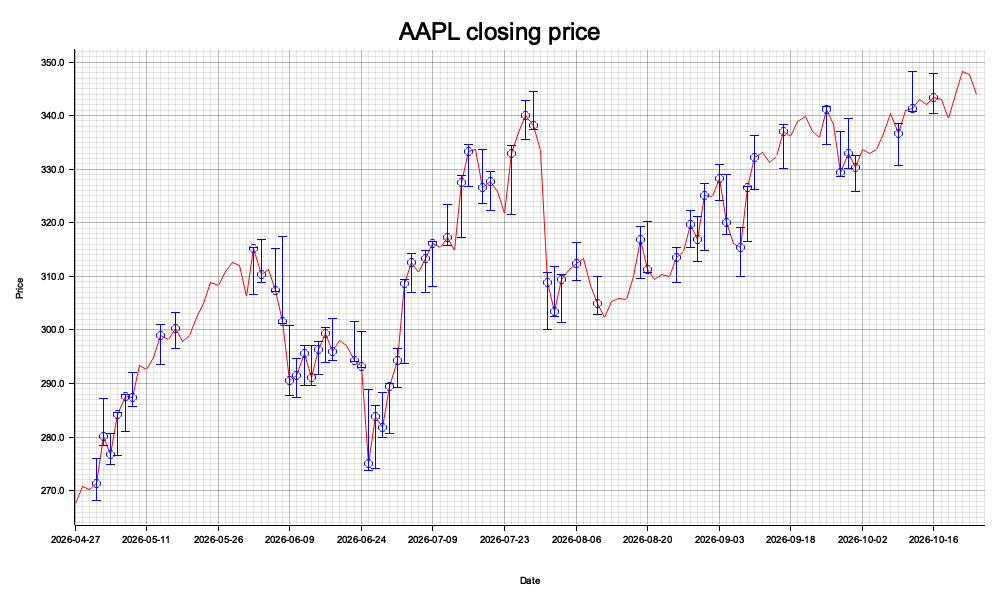

# stock-market-monitor

Fetches six months of daily quotes for a ticker, prints min/max closing price and dates, and writes a PNG chart (volatile days highlighted).



## Setup

Install [Rust](https://www.rust-lang.org/tools/install), then from this directory:

```bash
cargo build --release
```

## Usage

```bash
cargo run --release -- AAPL
./target/release/stock-monitor AAPL
```

With no ticker argument, the program prompts for symbols; press Enter on an empty line to quit. Bad tickers report an error and do not crash the program.

- **Chart file:** `tmp/<TICKER>_chart.png`
- **Help:** `cargo run --release -- --help`

The chart opens in your default image viewer when possible.

## Crates

| Crate | Why |
|---|---|
| `clap` | Command-line parsing and `--help` |
| `chrono` | Dates on quotes and the x-axis |
| `yahoo_finance_api` | Daily quotes from Yahoo Finance (blocking) |
| `plotters` | Render and save the chart as PNG |

## Financial analysis

Logic lives in `src/analysis.rs` (`summarize`). Over the fetched window:

- **Minimum / maximum:** trading days with the lowest and highest **closing** price (`Summary.min`, `Summary.max`), including dates.
- **Volatile days:** intraday swing more than 2% of the close — `((high - low) / close) × 100 > 2`, only when `close > 0`. Stored in `Summary.volatile`.

## Charting

`src/plot.rs` uses plotters (1000×600 bitmap PNG): red line of daily closes; blue vertical error bars (low–close–high) on volatile days; title and Date/Price axis labels; y-axis scaled to min/max **close** with 5% padding.
